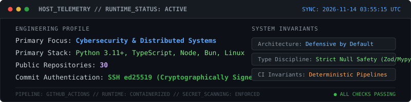
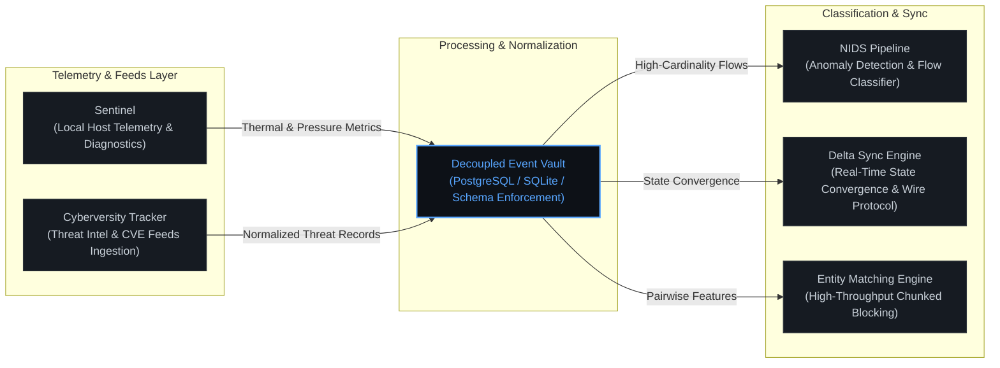

# Parth Gupta

Software & security engineer focused on defensive cybersecurity systems, host telemetry, distributed synchronization, and applied machine learning.

[Email](mailto:parthgupta.contact@gmail.com) · [LinkedIn](https://linkedin.com) · [Live Portfolio](https://body-explorer-kappa.vercel.app) · [GitHub](https://github.com/parth2024-tech)

  
  
  
  

  

---

### Systems Architecture Topology

The map below illustrates how core host telemetry, threat intelligence ingestion, anomaly classification, and distributed data pipelines connect across my engineering work:

---

### Overview

Most of my work centers around building deterministic, high-throughput software where data integrity, reliability, and security are non-negotiable. I enjoy designing systems from the ground up—from anomaly detection models evaluating gigabytes of network traffic to low-overhead telemetry agents running diagnostics on local hosts.

I write strictly typed Python and TypeScript, maintain comprehensive test coverage across every service I deploy, and favor clean, observable architectures over framework complexity.

---

### Selected Systems & Engineering Work

#### 1. [Sentinel](https://github.com/parth2024-tech/sentinel) — Industrial System Diagnostics & Posture Engine
A lightweight system telemetry and health diagnostics runtime designed to continuously evaluate local host status, thermal profiles, memory pressure, and security posture.
* **Architecture:** Decoupled telemetry ingestion pipeline with strict TypeScript type-checking (`noUncheckedIndexedAccess`, `exactOptionalPropertyTypes`) and runtime schema enforcement via Zod.
* **Key Implementation:** Replaced non-deterministic heuristics with a mathematical degradation-curve scoring algorithm (v2) and deterministic test suites verifying edge conditions and null safety.
* **Stack:** TypeScript, Node.js, Vite, Vitest, Zod.

#### 2. [Cyberversity Tracker](https://github.com/parth2024-tech/cyberversity-tracker) — Cyber Threat & Intelligence Ingestion Engine
A production-grade intelligence pipeline that aggregates, normalizes, and filters security feeds, vulnerability notices, and research trends across diverse APIs.
* **Architecture:** Multi-source ingestion layer with dedicated rate-limiters, backoff retries, and deduplication workers feeding a normalized PostgreSQL/SQLite vault.
* **Key Implementation:** Modular REST and GraphQL scraper architecture with Alembic database migrations, pre-commit quality enforcement, and containerized Docker runtime.
* **Stack:** Python 3.11+, FastAPI, Alembic, Docker, SQLite/PostgreSQL, uv.

#### 3. [Network Intrusion Detection System](https://github.com/parth2024-tech/network-intrusion-detection-system) — Machine Learning Anomaly Classifier
An end-to-end intrusion detection pipeline developed to identify malicious network activity and abnormal traffic flows using the CICIDS2017 benchmark dataset.
* **Architecture:** Scalable data preprocessing pipeline handling high-cardinality network flow records, feature selection, and class imbalance remediation.
* **Key Implementation:** Trained and tuned gradient-boosted ensembles evaluated on precision-recall curves to minimize false-positive alerts while maintaining high detection rates.
* **Stack:** Python, Scikit-learn, Pandas, NumPy, Jupyter.

#### 4. [Amazon ML Challenge Pipeline](https://github.com/parth2024-tech/Amazon-ML) — High-Throughput Entity Resolution
A large-scale entity resolution and matching pipeline designed to identify and link duplicate product records across 1.73M entities under strict latency and memory constraints.
* **Architecture:** Memory-efficient 16-channel chunked blocking strategy achieving 90.6% recall prior to pairwise classification, coupled with Parquet file checkpointing.
* **Key Implementation:** Extracted 49 pairwise topological, phonetic, and text features, coupled with a hybrid LightGBM and CUDA XGBoost ensemble calibrated to 98.4% precision on holdout sets.
* **Stack:** Python, LightGBM, XGBoost, CUDA, NumPy, Parquet.

#### 5. [Delta Sync Engine](https://github.com/parth2024-tech/delta-sync-engine) — Real-Time State Synchronization Runtime
A lightweight synchronization engine providing real-time state convergence, delta compression, and offline resilience for web clients.
* **Architecture:** Monorepo architecture featuring an offline-first event queue and delta-compression wire protocol to minimize network transmission costs.
* **Key Implementation:** Type-safe database queries mapped through Drizzle ORM with structured error handling and schema validation.
* **Stack:** TypeScript, Bun, Drizzle ORM, Docker.

---

### Technical Competencies

* **Languages & Runtimes:** Python (3.10+), TypeScript, JavaScript (ESNext), SQL, Bash, Bun, Node.js
* **Backend & Systems:** FastAPI, Express, REST & GraphQL APIs, Drizzle ORM, Alembic, Docker, Linux (Arch/Ubuntu)
* **Databases & Storage:** PostgreSQL, SQLite, Redis, Parquet, S3-compatible object storage
* **Security & Telemetry:** Network Intrusion Detection (NIDS), Traffic Flow Analysis, Host Diagnostics, Zod Null-Safety, Vulnerability Auditing
* **Machine Learning:** LightGBM, XGBoost, Scikit-Learn, Pandas, Feature Engineering, Classification & Anomaly Detection
* **Testing & Quality:** Vitest, Pytest, Conventional Commits, Strict Type-Checking, CI/CD Workflows

---

### Engineering Principles

1. **Defensive by Default:** Every external boundary—whether an API payload, user input, or network packet—must be validated against a strict schema. Runtime exceptions are design failures.
2. **Determinism over Assumptions:** Core logic, scoring algorithms, and data processors must produce reproducible outcomes backed by deterministic test cases.
3. **Observability & Minimal Clutter:** Systems should fail loudly with clear diagnostics, structured logs, and zero noise. Commits, code, and architectures should be clean, intentional, and readable by other humans.

---

  <i>Open to technical discussions, security collaboration, and engineering opportunities. Reach out via email or LinkedIn.</i>

